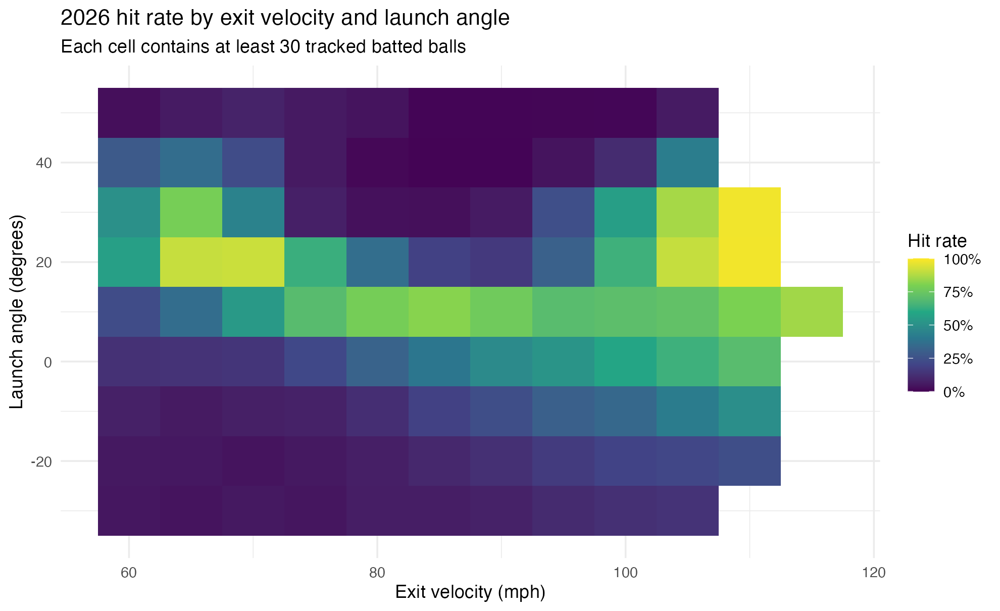
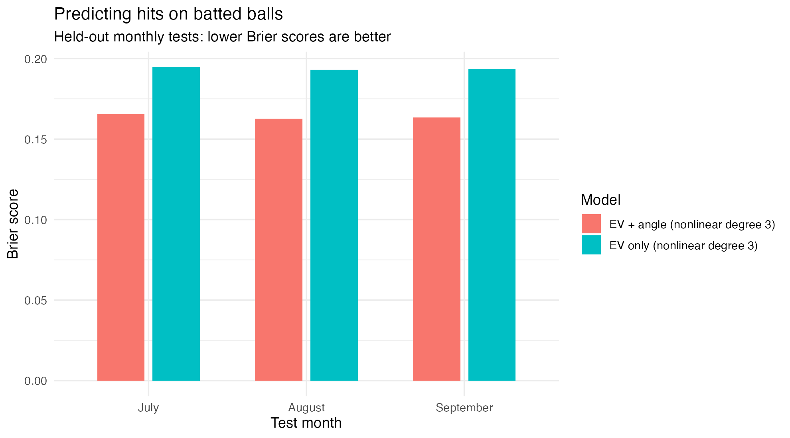
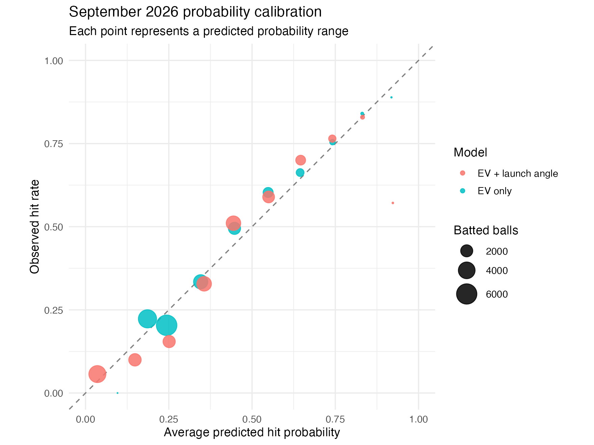
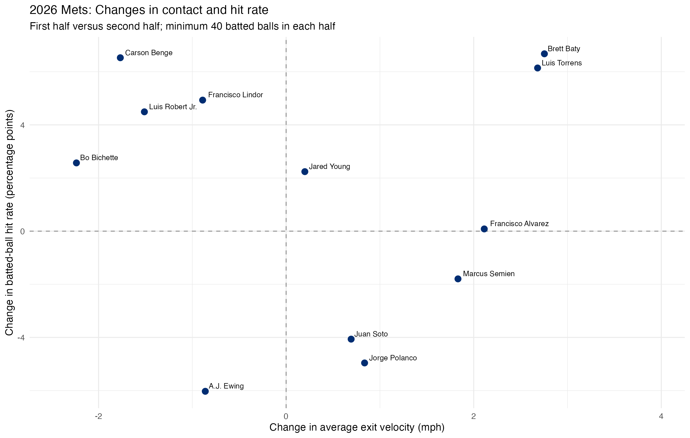

::: {.callout-note appearance="simple"}
## Project Overview

**124,100 batted balls analyzed | Four predictive models | Three out-of-sample test months**

I was curious to see how exit velocity and launch angle related to the likelihood of a batted ball resulting in a hit. My best-performing nonlinear model reduced the September Brier score by about **15.6%** relative to a nonlinear model with exit velocity as the only predictor.

I used the model to make predictions for contact made by New York Mets batters and compared them to actual results. I also looked at the differences in contact quality among Mets hitters between the first and second halves of the 2026 season.
:::

# Introduction
Of course, all else being equal, it’s better to hit the ball harder than softer in baseball. But exit velocity alone doesn’t tell the whole story, as a batted ball with an exit velocity of 105 mph that's hit into the ground is likely to have a different outcome than one hit at the same speed with a higher launch angle.

During a project for an introductory data science course at George Washington University, I first explored this question by looking at how exit velocity and launch angle relate to various offensive outcomes using [Statcast data](https://baseballsavant.mlb.com/statcast_search) from the 2026 MLB season. I was particularly intrigued by the ways in which launch angle moderated the relationship between exit velocity and the likelihood of a batted ball resulting in a hit. For example, for batted balls with launch angles between 20 and 30 degrees, those with exit velocities between 90 and 100 mph resulted in hits about 24.5 percent of the time, while batted balls with exit velocities between 100 and 110 mph resulted in hits about 73.1 percent of the time.

For this project, I sought to build on that initial exploration by developing and comparing models using over 124,000 batted balls from the 2026 MLB regular season. I evaluated the models' abilities to predict outcomes in later months of the season and used them to generate predictions for New York Mets hitters.

While I didn't intend for my models to replace Statcast’s own expected statistics, I wanted to see how accurately I could predict outcomes using exit velocity and launch angle, how much adding launch angle would improve those predictions, and what insights the models might offer about Mets hitters.

# Data and Methodology
## Data Collection and Preparation
I obtained Statcast data from MLB games played during the 2026 regular season (games played between March 25 and September 27 are included in the data). The data were provided in six CSV files and contained 124,611 observations, where each observation corresponded to a batted ball. The raw data included 119 variables, but for the most part I focused on just three: exit velocity (launch_speed), launch angle (launch_angle), and the outcome of the batted ball (events). I also kept variables indicating the date, game, batter, and teams so that I could evaluate models based on data from different time periods and look at results specifically for Mets batters.

Before fitting models, I removed observations with missing values for launch_speed, launch_angle, or events, resulting in 124,100 complete observations (511 observations were removed). Using the events variable, I created a new variable indicating whether or not the batted ball resulted in a hit (singles, doubles, triples, and home runs were labeled as hits, while all other results were labeled as non-hits).

Note that the hit rates discussed in this project are calculated only from tracked batted balls. They differ from traditional batting averages because batting average also includes at-bats that end in strikeouts, along with certain other outcomes that do not produce tracked batted balls.

## Predictive Models
My goal was to fit four different models to predict whether or not a batted ball resulted in a hit using launch angle and exit velocity. The first model was a logistic regression model that used exit velocity as the only predictor. The second model again used exit velocity as the only predictor, but I included squared and cubic terms to account for possible nonlinear relationships between exit velocity and the probability of getting a hit. The third model was a logistic regression model that used both exit velocity and launch angle as predictors. The fourth model again used both exit velocity and launch angle, but also included squared and cubic terms as well as interactions so that the effect of exit velocity on hit probability could depend on launch angle.

The first model was fit using the glm() function in R. The other three models were fit using the glmnet package with ridge regularization, which shrinks regression coefficients toward zero and can help stabilize estimates when predictors are highly correlated. Keep in mind that these models are predicting whether or not a given batted ball will result in a hit, not whether or not a batter will get a hit in a given plate appearance.

## Model Evaluation
I was interested in understanding how well the models I fit would perform in predicting new data (not just describe the data that was used to fit the models). To evaluate model performance, I fit each model using data from different training periods (March to June, March to July, and March to August) and then used the fitted models to predict hit probabilities for data from a new time period (July, August, and September, respectively).

To quantify prediction performance, I calculated the Brier score (the average of the squared differences between predicted hit probabilities and hit indicators) and log loss, which is another measure of predictive accuracy but penalizes confident incorrect predictions particularly heavily. For both measures, lower values indicate better predictions. I also calculated the area under the receiver operating characteristic curve (AUC), which is larger the better the model is at distinguishing hits from non-hits. For comparing the performance of different models, I mainly focused on the Brier score since I was primarily interested in how well hit probabilities were predicted.

To better understand the September predictions, I grouped September batted balls into groups based on predicted hit probability and compared the average hit probability in each group to the observed hit rate (calibration plot). I also compared my models’ September predictions to MLB’s expected batting average (estimated_ba_using_speedangle) for batted balls for which this quantity was available.

To quantify uncertainty in the difference between the Brier scores for the two models that included nonlinear terms, I performed a bootstrap analysis in which I resampled September games with equal probability 2,000 times (instead of resampling batted balls, I resampled games to account for the fact that data within a game might be correlated). This produced a 95% bootstrap confidence interval for the difference in Brier scores, allowing me to evaluate how consistently the model incorporating launch angle outperformed the model using exit velocity alone. However, resampling games does not fully account for repeated observations from the same hitters across different games.

# Exploratory Analysis
## Exit Velocity and Hit Probability
After exploring Statcast data on batted balls from the 2026 season, I wanted to dive a little deeper into exit velocity and launch angle and see if there was anything interesting about how they related to hitting before I started building any models.

Across all batted balls in 2026, the median exit velocity was 91.1 mph and the mean launch angle was about 13.5 degrees.

As expected, in general the harder the ball is hit, the more likely it is to result in a hit. But things get a little more interesting when you take launch angle into account.

For balls with a launch angle between 10 and under 20 degrees, those with an exit velocity between 90 and under 100 mph resulted in hits 72.61% of the time, compared to 71.45% for balls with an exit velocity between 100 and under 110 mph. So in this case, the hit rate is pretty similar even though there’s a pretty substantial difference in exit velocity.

But for balls with a launch angle between 20 and under 30 degrees, those with an exit velocity between 90 and under 100 mph resulted in hits 24.51% of the time, compared to 73.05% for balls with an exit velocity between 100 and under 110 mph, which is a difference of 48.54 percentage points!

The exact reasons behind this are a little beyond the scope of this project, but one possible explanation is that at higher launch angles the ball needs enough exit velocity to avoid being caught (or to go far enough to be a home run).

To visualize the relationship between launch angle and exit velocity a little more, I created the following heatmap showing the percentage of batted balls that result in a hit for each launch angle (in increments of 10 degrees) and exit velocity (in increments of 5 mph).

{#fig-contact-heatmap width=90%}

There are some pretty interesting patterns in this plot. As mentioned above, for some launch angles, the hit rate is high even for relatively moderate exit velocities. But for higher launch angles, exit velocity seems to play a bigger role.

Of course, there are a bunch of other factors that determine whether or not a batted ball results in a hit (where the ball is hit, dimensions of the ballpark, defensive positioning, etc.), so the goal here was not to explain everything that goes into determining hit rate. Rather, I wanted to show why considering exit velocity and launch angle together may be more useful than examining either measurement alone.

Note: I left off any (launch angle, exit velocity) combinations that had fewer than 30 observations to avoid showing potentially misleading information from extremely small sample sizes.

After seeing this plot and learning a little bit more about exit velocity and launch angle, I was curious to see if a model that incorporates both of these metrics (particularly one that allows for nonlinear effects and interactions between features) could do a better job of predicting hits than a model that just uses exit velocity.

# Predictive Modeling Results
## Comparing the Four Models
Of the four models, the model using both exit velocity and launch angle with nonlinear terms and interactions performed better than the other models in each of the three months of data that I tested on (July, August, September). For each month, I trained the models on previous months of data.

The following table shows the Brier score (lower is better for probability predictions) for each of the four models:

| Model | July | August | September |
|---|---:|---:|---:|
| EV only (linear) | 0.2029 | 0.2021 | 0.2023 |
| EV only (nonlinear) | 0.1946 | 0.1932 | 0.1936 |
| EV + launch angle (linear) | 0.2022 | 0.2010 | 0.2013 |
| EV + launch angle (nonlinear) | **0.1655** | **0.1628** | **0.1635** |

Launch angle adds very little predictive ability over exit velocity in a linear model (in September, the Brier score only improves from 0.2023 to 0.2013), but when I allow for nonlinearity, launch angle adds a decent amount of predictive ability. In September, the Brier score improves from 0.1936 for the exit-velocity-only model to 0.1635 for the model using both exit velocity and launch angle, an improvement of about **15.6 percent**. In July and August, adding launch angle improves the Brier score by about 14.9 percent and 15.8 percent, respectively.

{#fig-model-validation width=90%}

For September, the log loss and AUC also improve quite a bit when using a nonlinear model that includes both exit velocity and launch angle (log loss: 0.4921 vs. 0.5741; AUC: 0.8124 vs. 0.6805).

Using 2,000 bootstrap resamples of the 360 games in the September data, the 95 percent bootstrap confidence interval for the improvement in Brier score using both exit velocity and launch angle instead of just exit velocity is 0.0282 to 0.0320 (the observed improvement is about 0.0301). This suggests that launch angle adds predictive ability in the September data, although it's possible the improvement would be different in other seasons (I only have one season of MLB data to test on).

## Probability Calibration
It would be nice if, when the models predict a 60 percent chance of a hit, the hit rate is around 60 percent for all batted balls where the model made that prediction. The following graph shows how close the models come to that ideal:

{#fig-calibration width=90%}

For September, most of the larger groups fall reasonably close to the ideal calibration line. There are a couple of instances where the model using both exit velocity and launch angle predicts hits will occur at a rate quite different from what actually happens. However, in these instances there weren't a large number of batted balls, so I wouldn't put too much stock in those results. For example, in one instance the model using both exit velocity and launch angle predicts hits will occur at a rate above 90 percent, but the actual hit rate is much lower. This prediction only applied to a relatively small number of batted balls.

This graph also serves as a reminder that a model can do well overall but not have perfectly calibrated probability predictions in all situations.

## Comparison with Statcast Expected Batting Average
MLB Statcast calculates an expected batting average (xBA) using a more developed process than what I used above. For the 18,089 September batted balls where Statcast xBA was available, Statcast xBA does a better job predicting hits than either of my nonlinear models according to all three metrics I used above.

| Model | Brier Score | Log Loss | AUC |
|---|---:|---:|---:|
| Statcast xBA | **0.1306** | **0.4025** | **0.8773** |
| EV only (nonlinear) | 0.1952 | 0.5777 | 0.6815 |
| EV + launch angle (nonlinear) | 0.1641 | 0.4936 | 0.8136 |

This shouldn't be too surprising, since Statcast's methodology differs from mine and uses a more developed approach to estimating expected outcomes.

My goal wasn't to try to do a better job calculating expected statistics than MLB already does, but rather to see how much of an improvement including launch angle could provide over using just exit velocity to predict hits off the bat.

It appears that using both exit velocity and launch angle, especially in a model that allows for some nonlinearity and interaction between the two variables, can provide a pretty sizable improvement over using exit velocity alone. However, as shown above, there is likely still quite a bit of room for improvement.

# Applying the Model to the Mets
## First-Half vs. Second-Half Performance
For the Mets, I was curious to see how their batted-ball statistics changed between the first half of the season (games through July 12) and the second half (games from July 16 onward). In particular, I wanted to see whether changes in exit velocity and launch angle accompanied changes in their batted-ball hit rate.

As it turns out, the Mets’ batted-ball hit rate went up by about **2.4 percentage points** in the second half of the season, but there weren’t huge changes in contact quality overall:

| Statistic | First Half | Second Half |
|---|---:|---:|
| Tracked batted balls | 2,488 | 1,665 |
| Hits | 757 | 547 |
| Batted-ball hit rate | 30.4% | 32.9% |
| Average exit velocity | 89.0 mph | 89.4 mph |
| Median exit velocity | 92.1 mph | 92.7 mph |
| Average launch angle | 12.5° | 13.7° |
| Hard-hit rate (95+ mph) | 41.4% | 42.5% |

Average exit velocity ticked up only 0.4 mph, and hard-hit rate increased by about 1.1 percentage points. Launch angle also increased a tad, from 12.5 to 13.7 degrees.

So, although the Mets’ batted-ball hit rate increased noticeably from the first half to the second half of the season, that increase wasn’t matched by big changes in exit velocity or launch angle. Of course, as noted above, there are many factors that go into whether a batted ball will drop in for a hit besides exit velocity and launch angle, and shifts in which players are playing can also impact team-level stats.

So I took a look at exit velocity and batted-ball hit rate for individual Mets hitters (those with at least 40 tracked batted balls in each half, and twelve qualified) and compared the first half of the season to the second half:

{#fig-mets-half-comparison width=90% fig-pos="H"}

There’s quite a bit of variation player-to-player. For instance, Brett Baty’s batted-ball hit rate improved by 6.68 percentage points in the second half, and that increase was accompanied by increases in exit velocity (2.75 mph) and hard-hit rate (7.86 percentage points).

But for Carson Benge, whose batted-ball hit rate increased by 6.53 percentage points in the second half, exit velocity actually decreased (by 1.77 mph), as did hard-hit rate (by 6.97 percentage points). Francisco Lindor also saw an increase in batted-ball hit rate (4.93 percentage points) coupled with a slight decrease in exit velocity in the second half.

Meanwhile, Juan Soto’s exit velocity increased by about 0.69 mph in the second half, but his batted-ball hit rate went down by 4.06 percentage points. Francisco Alvarez’s exit velocity went up 2.11 mph, but his batted-ball hit rate barely budged.

So, as I alluded to earlier when I first explored the Statcast data, increased exit velocity doesn’t always equate to increased batted-ball hit rate. But I don’t want to imply that changes in exit velocity caused changes in batted-ball hit rate (or vice versa). There could be a host of other factors at play, including launch angle, direction of contact, defensive positioning, and randomness, and we’re only talking about two halves of one season here, so sample sizes could be playing a role.

## July-September Model Predictions
I also was curious to see how well my model did predicting batted-ball hit rate for Mets hitters from July-September. Using my best-performing model (the nonlinear model with exit velocity and launch angle), I made batted-ball hit rate predictions for Mets hitters in July, August, and September, training my model on data from prior months each time so that I could evaluate my model’s performance on data it wasn’t trained on.

From July-September, there were 1,966 tracked batted balls from Mets hitters. Of those, 645 were hits; my model expected about 638.3 hits to occur, so in total, the Mets exceeded my model’s expectations by about 6.7 hits.

Breaking things down by hitter (for Mets hitters with at least 40 tracked batted balls from July-September):

| Player | Batted Balls | Actual Hits | Expected Hits | Difference |
|---|---:|---:|---:|---:|
| Bo Bichette | 237 | 79 | 80.8 | -1.8 |
| Francisco Lindor | 230 | 70 | 70.3 | -0.3 |
| Carson Benge | 215 | 87 | 72.2 | +14.8 |
| A.J. Ewing | 205 | 68 | 69.4 | -1.4 |
| Marcus Semien | 170 | 44 | 48.2 | -4.2 |
| Jared Young | 163 | 56 | 55.4 | +0.6 |
| Juan Soto | 133 | 39 | 42.7 | -3.7 |
| Brett Baty | 126 | 48 | 46.4 | +1.6 |
| Francisco Alvarez | 117 | 42 | 41.9 | +0.1 |
| Luis Torrens | 89 | 29 | 27.9 | +1.1 |
| Luis Robert Jr. | 74 | 24 | 23.3 | +0.7 |
| Jorge Polanco | 55 | 10 | 13.6 | -3.6 |

For the most part, hitters didn’t stray too far from the number of hits my model expected. Bo Bichette, Francisco Lindor, and A.J. Ewing, for example, all fell within two hits of expectations.

Carson Benge, however, exceeded my model’s expectations by a fair amount: He accrued 87 hits off of 215 tracked batted balls from July-September, whereas my model expected him to accrue about 72.2 hits, representing a difference of about **14.8 hits** (6.89 percentage points).

Using my model’s batted-ball hit rate predictions, the standard deviation in the number of hits Benge was expected to accrue from July-September was about 6.33 hits, meaning that Benge exceeded my model’s expectations by about 2.34 standard deviations.

This is a larger discrepancy than what I found when examining September alone, and I think it would be interesting to take a deeper look into. That said, I wouldn’t necessarily say that this discrepancy means that Benge was particularly lucky or that there’s some facet of his hitting that my model failed to capture. This calculation assumes that batted-ball outcomes are independent and treats the model’s predicted probabilities as fixed, without accounting for uncertainty in the model itself. And since I took a look at multiple hitters, it’s possible that one of them exceeded my model’s expectations by a relatively large margin just by chance.

Other factors that my model didn’t account for, such as where in the park the ball was hit and where defenders were positioned, could also help to explain discrepancies between hitters’ actual batted-ball hit rates and what my model would’ve predicted given only exit velocity and launch angle data.

## What These Results Suggest
Another interesting facet of the results was looking at hitters whose hit rates went up or down relative to exit velocity. At the team level, the Mets saw their hard-hit rate and average exit velocity tick up only slightly from the first half to the second half, but saw an increase in hit rate on tracked batted balls.

Looking at individual hitters, there were some interesting differences. Brett Baty saw an increase in hit rate accompanied by harder contact, while Carson Benge saw a similar increase in hit rate despite a decrease in average exit velocity and hard-hit rate.

Looking at Mets hitters’ actual versus expected hits in July-September, we see that while the Mets as a whole had a number of hits that wasn’t terribly far off from what my model would’ve predicted, there were some hitters who saw larger discrepancies between actual and expected performance. Again, Carson Benge’s numbers are an interesting case, but I would hesitate to read too much into any conclusions about individual hitters based on this analysis.

One caveat to the analysis above is that the second-half versus first-half results are looking at the actual contact Mets hitters made during each half, whereas the actual versus expected performance for Mets hitters in July-September is looking at how well my model was able to predict hit rate on new data. These are related, but subtly different, questions. Additionally, looking at Mets hitters’ actual versus expected hits in July-September is not exclusively looking at hitters’ second-half performance, as there were games included prior to the All-Star break.

Ultimately, I found it interesting to see that changes in exit velocity metrics don’t necessarily translate to similar changes in hit rate metrics. While exit velocity and launch angle provide valuable information about batted balls, it’s clear that there’s more to be investigated before using a model like this to draw conclusions about individual hitters. Some areas for further exploration could include using other Statcast metrics, looking at whether trends in actual versus expected hits persist over multiple seasons, and whether changes in exit velocity metrics could be used to predict changes in run production for teams.

# Limitations and Conclusions
## Limitations
There are a couple limitations to note here. First, my analysis only includes tracked batted-ball events from the 2026 MLB season, so the results don’t account for other plate appearances like walks, strikeouts, or hit-by-pitches. The hit rates discussed here are only on batted-balls and should not be confused with a player’s batting average or overall hitting ability.

Second, exit velocity and launch angle alone don’t provide a full picture of batted-ball events. Batted balls with the same exit velocity and launch angle can end up as hits or outs based on factors like batted-ball direction, ballpark, weather, fielder positioning, etc. My models may be able to do a better job predicting hits if I included some of these additional variables.

Third, I opted to use fairly basic logistic regression models instead of other more sophisticated machine learning techniques and didn’t do an exhaustive model-building exercise to determine the best regularization technique(s) or search extensively through model specifications. Other approaches may yield better results.

Fourth, although I trained my models using data from earlier in the season and measured predictive accuracy using data from later in the season, all of the data still comes from within the 2026 MLB season. It would be useful to see how these models perform using data from future MLB seasons.

Fifth, Statcast’s expected batting average (xBA) outperformed my best model when I compared September predictions to actual results. On the same set of batted-ball events, my model had a Brier score of approximately 0.164, compared with 0.131 for xBA. This isn’t too surprising given that Statcast’s expected stats account for even more information and are specifically designed to assess batted-ball events.

Finally, as seen in my analysis of the Mets, actual results for individual players can deviate from what my models would expect even if the models do a decent job overall. We shouldn’t necessarily chalk these deviations up to luck or assume that they point to any sort of underlying hitting talent given that (a) my models don’t account for all of the factors that determine whether a batted-ball results in a hit and (b) the sample sizes may not always be big enough to draw strong conclusions.

## Conclusions
When I began this project, I wanted to know whether exit velocity by itself is a good enough indicator of whether a batted-ball event results in a hit or whether accounting for launch angle provides meaningful predictive improvement. Based on what I found, launch angle provides meaningful predictive improvement, especially when allowing for nonlinearity. For instance, in September, the nonlinear exit-velocity-only model had a Brier score of approximately 0.194, compared with 0.163 for the nonlinear model that included both exit velocity and launch angle. That's an improvement of approximately 15.6%. Similar patterns emerged when repeating this exercise for July and August.

My exploratory analysis suggested one reason why accounting for launch angle could improve predictive accuracy: the relationship between exit velocity and hit probability depends on launch angle. Making strong contact matters, but the degree to which it matters can fluctuate quite a bit depending on launch angle.

I thought the application of this analysis to the Mets was especially interesting. The Mets batted-ball hit rate ticked up during the second half of the season despite just small upticks in exit velocity and hard-hit rate, and the ways in which these trends played out varied quite a bit from player to player. The aggregate predictions from my exit velocity and launch angle models tracked pretty well with the actual number of hits the Mets tallied from July through September, although some individual players, Carson Benge in particular, deviated from what I’d expect based on these models.

If I had more time to devote to this project, I’d like to add other Statcast variables to my models, try more sophisticated machine learning techniques, see how these models perform using data from other MLB seasons, and dig into whether models like these could help flag changes in player performance prior to those changes showing up in more traditional metrics.

In the end, this project helped me dig deeper into the notion that making strong contact matters but doesn’t paint the whole picture: exit velocity is helpful for understanding batted-ball events, but launch angle adds important context. Accounting for both provided predictive lift relative to exit velocity alone and shined a light on some interesting trends for the Mets during the 2026 MLB season.

# References
## R and Software Packages
R Core Team. (2026). *[R: A Language and Environment for Statistical Computing](https://doi.org/10.32614/R.manuals)*. R Foundation for Statistical Computing, Vienna, Austria.

Wickham, H., Hester, J., & Bryan, J. (2026). *[readr: Read Rectangular Text Data](https://doi.org/10.32614/CRAN.package.readr)* (R package version 2.2.0).

Wickham, H., François, R., Henry, L., Müller, K., & Vaughan, D. (2026). *[dplyr: A Grammar of Data Manipulation](https://doi.org/10.32614/CRAN.package.dplyr)* (R package version 1.2.1).

Wickham, H. (2016). *[ggplot2: Elegant Graphics for Data Analysis](https://doi.org/10.1007/978-3-319-24277-4)*. Springer-Verlag New York.

Friedman, J., Hastie, T., & Tibshirani, R. (2010). [Regularization paths for generalized linear models via coordinate descent](https://doi.org/10.18637/jss.v033.i01). *Journal of Statistical Software, 33*(1), 1–22.

Tay, J. K., Narasimhan, B., & Hastie, T. (2023). [Elastic net regularization paths for all generalized linear models](https://doi.org/10.18637/jss.v106.i01). *Journal of Statistical Software, 106*(1), 1–31.

Wickham, H., Vaughan, D., & Girlich, M. (2025). *[tidyr: Tidy Messy Data](https://doi.org/10.32614/CRAN.package.tidyr)* (R package version 1.3.2).

Wickham, H., Pedersen, T. L., & Seidel, D. (2025). *[scales: Scale Functions for Visualization](https://doi.org/10.32614/CRAN.package.scales)* (R package version 1.4.0).

Müller, K., & Wickham, H. (2026). *[tibble: Simple Data Frames](https://doi.org/10.32614/CRAN.package.tibble)* (R package version 3.3.1).

## Data Source
Major League Baseball. (2026). *[Baseball Savant: Statcast Search](https://baseballsavant.mlb.com/statcast_search)*.